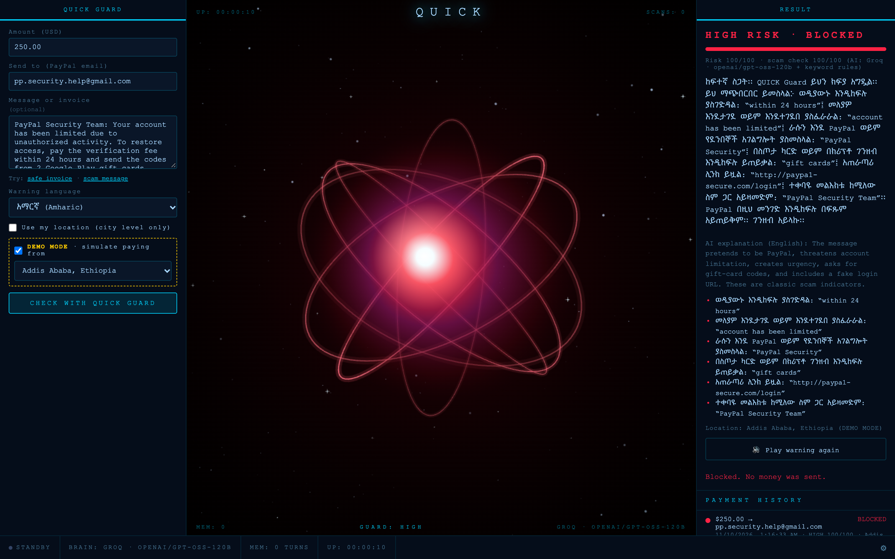
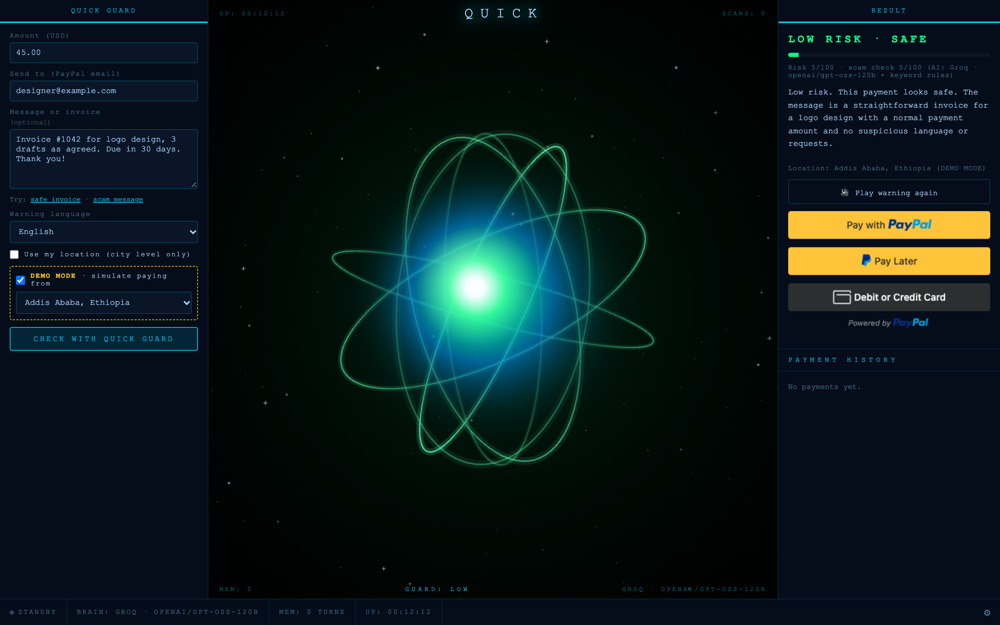
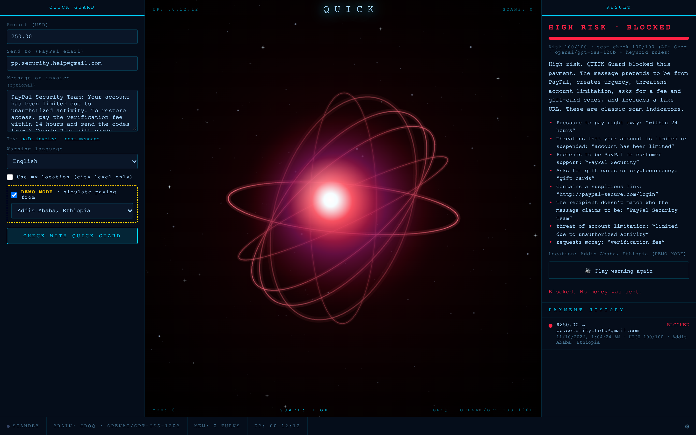

# QUICK Guard

**An AI guardian that checks a PayPal payment for scams and account takeover *before* any money moves.**

### ▶ Live demo: **https://quick-guard.onrender.com**

> **First load may take up to a minute while the free server wakes up.**
> Uses the **PayPal Sandbox** only, so no real money ever moves. Built for the PayPal AI Hackathon 2026.



## The problem

PayPal's systems are secure, but scammers target the *person*: fake invoices, "your account is limited"
notices, fake support numbers, "I'm in trouble, don't tell anyone." Victims send the money themselves, so
fraud systems see a legitimate payment. Many of the people hit hardest are first-time digital-payment users
who may not read English well, so a warning has to be simple, spoken, and in their own language.

QUICK Guard sits **in front of the PayPal button**. Every payment is checked first, and the server, not
the browser, decides whether PayPal is even allowed to create the order.

## How judges can test it

Open **https://quick-guard.onrender.com** on a laptop (Chrome, Edge, Firefox or Safari). Turn your sound on
to hear the spoken warnings. Tick **DEMO MODE** so the site uses a sample city instead of your real location.

### 1. A safe payment (≈ 30 seconds)
1. Tick **DEMO MODE** and pick **Addis Ababa, Ethiopia**.
2. Click **Try: safe invoice**. In **Send to**, paste the **sandbox business email** from the
   [judge test account](#judge-test-account) below (that's who receives the fake sandbox money).
3. Click **CHECK WITH QUICK GUARD**.
4. The orb turns **green**: **LOW RISK · SAFE**, and the PayPal buttons appear.
5. Click **Pay with PayPal** and log in with the **judge test account** below. After you approve, the
   payment is captured and appears as **PAID** in Payment history.

### 2. A scam blocked, with an Amharic voice warning (≈ 20 seconds)
1. Click **Try: scam message** (a fake "PayPal Security Team: your account has been limited…" notice),
   and type any recipient, e.g. `pp.security.help@gmail.com`.
2. Set **Warning language** to **አማርኛ (Amharic)**.
3. Click **CHECK WITH QUICK GUARD**.
4. The orb turns **red**: **HIGH RISK · BLOCKED**. The explanation and red flags appear in Amharic, each
   flag quotes the exact words that gave the scam away, the warning is **spoken aloud in Amharic**
   (click **Play warning again** if your browser blocked autoplay), and **no PayPal buttons are shown**.
   The Amharic warning is built only from pre-written, reviewed Amharic sentences, never free-form AI
   Amharic. The AI's own explanation is shown underneath in English. The server also refuses to
   create a PayPal order for this check, even if someone calls the API directly.

### 3. Impossible travel (≈ 1 minute; do test 1 first)
1. Complete test 1, a real sandbox payment from **Addis Ababa**. That city is now your trusted location.
2. In DEMO MODE, switch the city to **Tokyo, Japan**.
3. Click **Try: safe invoice** again (same sandbox business email) and **CHECK WITH QUICK GUARD**.
4. Result: **HIGH RISK · BLOCKED**. The message is harmless, but getting from Addis Ababa to Tokyo in a few
   minutes would mean traveling at hundreds of thousands of km/h, so it looks like someone else is using
   the account.

You can also paste any message you've received into the box and see what QUICK Guard says. Warnings are
available in English, Amharic, Spanish, French, Mandarin, Hindi and Nepali.

### Judge test account

These are **PayPal Sandbox** test accounts. They hold fake sandbox money only, and no real money moves.

| | |
|---|---|
| **Send to** (sandbox business email, paste into the form) | `[FILL IN: sandbox business email]` |
| Sandbox buyer email (log in to the PayPal popup) | `[FILL IN: sandbox buyer email]` |
| Sandbox buyer password | `[FILL IN: sandbox buyer password]` |

Checks and payment history live in server memory, so a server restart (or ~15 minutes) clears them.
If the impossible-travel test shows LOW, run test 1 again first.

## Screenshots

All taken on the live site with DEMO MODE on.

| Safe payment → PayPal buttons | Scam blocked | Scam blocked, in Amharic |
|---|---|---|
|  |  |  |

## How it works

```
 amount, recipient, message ─► POST /api/guard/check
 (+ city-level location)         ├─ scam check: keyword rules (7 languages)  ┐
                                 ├─ scam check: AI (Groq)                    ├─► risk engine ─► LOW / MEDIUM / HIGH
                                 └─ location vs last trusted city ───────────┘
 LOW            ─► PayPal buttons shown
 MEDIUM         ─► "Yes, this is me" ─► PayPal buttons shown
 HIGH           ─► blocked: no buttons, and the server refuses to create an order
 PayPal button  ─► POST /api/paypal/order (re-checked) ─► buyer approves ─► POST /api/paypal/capture (re-checked)
```

- **Risk score** = the higher of the scam score and the location score. LOW < 40 ≤ MEDIUM < 70 ≤ HIGH.
  If the scam score and the location score are both ≥ 40, the result is always HIGH.
- **Impossible travel:** faster than 900 km/h since the last trusted payment = 90 points (HIGH);
  500–900 km/h = 50 points (MEDIUM).
- **Evidence rule:** every red flag must quote words that are really in the message. The AI may raise a
  payment to MEDIUM or HIGH only if one of its quotes checks out, and it can never *lower* the keyword score.

### Which AI we use

| Layer | What |
|---|---|
| Main model | **Groq, `openai/gpt-oss-120b`** (OpenAI's open-weight model, low reasoning effort, strict JSON output) |
| Backup model | **Groq, `openai/gpt-oss-20b`**, used automatically when the first model hits the free-tier rate limit |
| Fallback | **Keyword rules** in 7 languages, which always run. If the AI is down, Guard still protects with these alone. |

Every result shows which model actually answered, or "keyword rules only". Identical messages within
10 minutes reuse the cached answer. For local development, `AI_PROVIDER=ollama` runs Llama 3 on your own machine.

## Security features

- **PayPal Sandbox only.** The server refuses to start unless `PAYPAL_MODE=sandbox`, and there is no live PayPal URL in the code.
- **The server is the gate.** Creating and capturing an order both re-check the saved result. A HIGH or unconfirmed MEDIUM payment can't be paid, even by calling the API directly.
- **No double payments.** Capture claims the check atomically before calling PayPal, and PayPal's `PayPal-Request-Id` makes the capture idempotent.
- **Secrets stay secret.** Keys live only in `.env` (local) or Render environment variables. The app's logs never contain keys, tokens, full payment bodies or IP addresses.
- **Privacy.** Location is rounded to about 11 km the moment it arrives, and exact GPS is never stored. Nothing is written to disk: checks and history live in memory and expire.
- **Reviewed Amharic only.** In Amharic, everything shown and spoken comes from pre-written, reviewed sentences (risk level, red-flag names, advice). The AI only scores the message and quotes the evidence.
- **Prompt-injection resistant.** Message text is fenced and labeled as data for the AI. Trying to talk the checker into "safe" adds +40 risk. AI flags that don't quote the message are dropped.
- **Input validation.** Amount 0.01–10,000.00 USD; strict email format; message ≤ 5,000 characters; request bodies ≤ 256 KB.
- **Rate limiting.** 30 checks per 10 minutes, per browser session and per visitor IP (the real IP behind Render's and Cloudflare's proxies, which can't be faked by headers).
- **No HTML injection.** Every server value is inserted as plain text.
- **Hardened cookies.** `HttpOnly`, `SameSite=Lax`, and `Secure` on the live site.
- **Powerful local tools are off.** QUICK's original desktop tools (chat, code runner, scanners, microphone) return 403 and are hidden on the public site.
- **Tested.** 243 automated tests, including attack tests: prompt injection, XSS, malformed input, double-capture races, spoofed IP headers.

## Run it locally

You need **Python 3.13** (the version the live site runs, pinned in `.python-version`) and **git**.

```bash
# 1. Clone
git clone https://github.com/yabseraermias2-hash/quick-guard.git
cd quick-guard

# 2. Create and activate a virtual environment
python3.13 -m venv venv           # Windows: py -3.13 -m venv venv
source venv/bin/activate          # Windows: venv\Scripts\activate

# 3. Install packages
pip install -r requirements.txt

# 4. Add your settings
cp .env.example .env
# then open .env and add your PayPal *sandbox* Client ID and Secret
# (developer.paypal.com → Apps & Credentials → Sandbox) and a Groq API key (console.groq.com)

# 5. Check your Groq key (optional), then run
python scripts/check_groq.py
python server.py
```

Then open the `http://localhost:PORT` address the server prints. Run the tests with
`pip install -r requirements-dev.txt` and `python -m pytest -q`.

**AI provider:** set `AI_PROVIDER=groq` (default model `openai/gpt-oss-120b`, backup `openai/gpt-oss-20b`)
or `AI_PROVIDER=ollama` to use a local Llama 3 (`ollama pull llama3`).

**Deploying:** `render.yaml` is a Render Blueprint. In Render choose New → Blueprint, pick this repo,
and paste `PAYPAL_CLIENT_ID`, `PAYPAL_CLIENT_SECRET` and `GROQ_API_KEY` when asked.

## Built with

Python · Flask · Gunicorn · PayPal Orders API v2 and JavaScript SDK (Sandbox) · Groq (`gpt-oss-120b` / `gpt-oss-20b`) ·
Ollama (local development) · Microsoft Edge neural voices (`edge-tts`) · Render · pytest · Playwright · Claude Code

More detail: [QUICK_GUARD_BRIEF.md](QUICK_GUARD_BRIEF.md).

## How it was built

Built solo by Yabsera Kebede, with [Claude Code](https://claude.com/claude-code) as an AI coding assistant
for writing code, tests and reviews. Deployed on Render from the `main` branch.

## License

[MIT](LICENSE)

---

**Built by Yabsera Kebede.**
